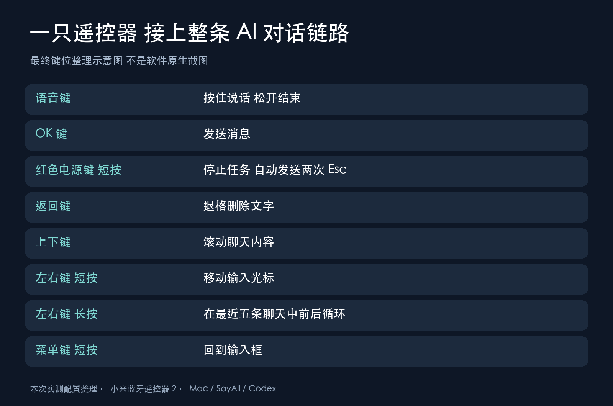

# Codex Remote Cycle


*AI 生成的趣味封面：用遥控器语音输入，让思考和讲述更自由。*

用小米遥控器配合无线麦 SayAll，在最近五条本机 Codex 对话之间前后循环切换。每次按键启动一次，打开聊天后退出，不新增常驻服务，也不发起网络请求。

这个项目来自一次真实使用：我想离开键盘，像拿着话筒一样讲述需求、整理思路。可以来回踱步，也可以坐在摇摇椅上，先把想法理顺再说给 AI。语音输入之外，发送、停止、删除、滚动和返回输入框也需要顺手，才有完整的体验。



上图是本次配置的整理示意图，其他按键功能由 SayAll 配置。**本仓库提供的是最近五条聊天的循环切换程序，不是语音识别工具，也不是 SayAll 的分支。**

## 已验证到哪一步

- 原型在一台 Mac 的 Codex 桌面环境、SayAll 1.9.21 和小米蓝牙遥控器 **2** 上，完成了右长按切走、左长按返回的真人测试。
- 原型状态文件确认包含五条聊天，切换后进程已退出。
- 公开源码去掉了原型中的个人聊天 ID，加入并发保护和索引查询错误处理；构建和循环逻辑测试通过。
- 公开版本首次使用从名单入口开始，**未在第二台 Mac 上验收**，也没有声称兼容所有 Codex 版本。

## 工作原理和边界

1. 只读 `~/.codex/state_5.sqlite`，按 `recency_at_ms`（回退到 `updated_at_ms`）取最近五条符合条件的本机聊天。
2. 名单成员不变时保持原来的顺序，避免打开聊天造成排序变化、反复跳回同一项。
3. 名单成员变化时刷新名单，保留仍在名单里的当前位置。
4. 通过 `codex://threads/<id>` 请求 Codex 打开目标，保存位置后退出。

**这不是当前窗口识别器。** 它跟踪的是本工具上次切到的位置；中途用鼠标或其他快捷键另选聊天，不会自动同步位置。首次使用或原位置被移出名单时，“下一条”打开名单第一项，“上一条”打开最后一项。

Codex 接受打开请求并不代表页面已经成功加载。本程序无法验证页面最终是否渲染完成；权限、索引版本或深链接行为变化仍可能影响使用。

索引是 Codex 的内部格式。当前查询排除归档、空预览、附属对话，并使用原型环境中的 `source='vscode'` 等条件；不覆盖云端、远程主机或普通 ChatGPT 聊天。不能把它当成跨版本的官方接口。

## 构建

需要 macOS、已安装的 Codex 桌面应用和 Xcode Command Line Tools。只使用系统 Swift、AppKit、SQLite，无需安装第三方包。首次安装编译工具可能产生下载流量；构建脚本不会自动下载安装工具。

```sh
git clone https://github.com/gkgy/codex-remote-cycle.git
cd codex-remote-cycle
bash scripts/build.sh
```

`build/` 中会生成：

- `Codex 最近聊天－上一条.app`
- `Codex 最近聊天－下一条.app`

程序使用本机构建的 ad-hoc 签名，没有 Apple Developer ID 公证。请从源码自行构建，不要关闭 Gatekeeper。放好位置后再绑定 SayAll；移动或删除应用会让原绑定失效。

## 在 SayAll 中绑定

1. 打开“按键映射”，确认已连接遥控器，并启用自定义按键功能。
2. 左键的**单击**保留“方向左”。左键的**长按**选择“打开自定义 APP”，添加 `build/Codex 最近聊天－上一条.app`，聚焦方式选择“只打开 APP”。
3. 右键的**单击**保留“方向右”。右键的**长按**同样选择 `build/Codex 最近聊天－下一条.app`。
4. SayAll 需要输入监控和辅助功能权限。按系统要求完成授权。
5. 回到 Codex，长按右键一次，再长按左键一次，确认前后切换结果；继续测试绕回名单起点。

设置长按后，SayAll 会等待区分短按与长按，原来的按住方向键连续移动行为可能变化。每次长按切换一次，松开再按以继续。

**不需要在 Codex 中设置 F18/F19。** 它们只是排查时用来验证遥控器确实发送按键的中间方案，最终由 SayAll 直接打开上述应用。

原型曾尝试 Codex 的“上一个／下一个最近查看的聊天”，但在测试环境中直接点击命令也没有切换。因此本项目提供自己的名单和循环位置，没有修改 Codex 安装包。

## 检查和重置

只计算目标，不打开聊天、不改当前位置：

```sh
build/CodexCycle --dry-run
build/CodexCycle --dry-run --previous
```

输出包含本机聊天 ID，请不要把输出当作公开日志上传。首次运行会创建状态目录和锁文件。

运行纯循环逻辑测试：

```sh
xcrun swiftc Sources/Ring.swift scripts/test.swift -o /tmp/codex-cycle-test
/tmp/codex-cycle-test
```

状态保存在 `~/Library/Application Support/CodexRemoteCycle/state.json`。要重置，可在 Finder 的“前往文件夹”打开该目录，将 `state.json` 移到废纸篓；下一次从名单入口开始。不需要删除 Codex 的聊天数据库。

## 隐私和退出行为

- 查询返回聊天 ID，不读取消息正文，不写入 Codex 数据库。
- 本地状态保存最多五条聊天 ID 和当前位置，不包含聊天标题或正文。
- 不注册开机启动、后台服务、全局键盘监听或网络监听。
- 打开目标后退出，异常等待最多约十秒；并发触发时跳过重叠请求。
- Codex 自己加载聊天时可能联网，这与本工具不发起网络请求是两回事。

## 完整使用故事

[阅读带图文章](docs/article/article.md) · [查看配图](docs/article/images)

文章讲的是小米遥控器 2 和 SayAll 的整套使用经历；本仓库只发布其中我们编写的循环切换代码与原创说明，SayAll 仍由其原项目维护。

相关链接：[SayAll](https://github.com/HD838A/remote-mic-app) · [Codex 命令与深链接](https://learn.chatgpt.com/docs/reference/commands)

许可证：代码采用 [MIT](LICENSE)。截图属于对应软件界面，用于说明实际设置过程。
