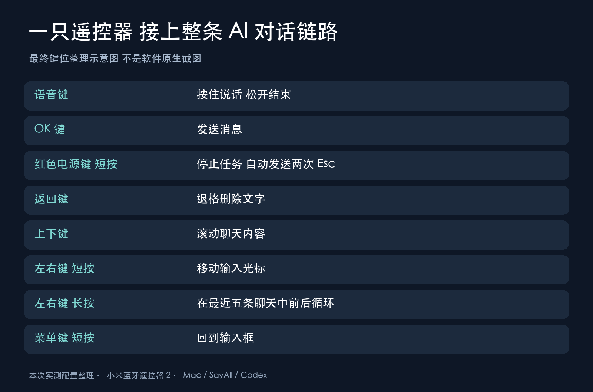
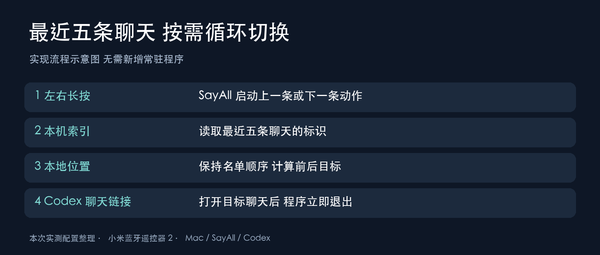

# 我把小米遥控器2变成了Codex控制器 语音编程之外还有这些坑

*AI 生成的趣味插画，非产品实拍。*

买了这只小米蓝牙遥控器 2，真正用起来以后，我最喜欢的，并不是它能帮我少打几个字。

而是终于能离开键盘，像拿着一个小话筒，和 AI 好好说话。

坐在电脑前敲字时，我总会一边组织语言，一边管着光标、快捷键和鼠标。换成握着遥控器、按住语音键说，我更容易进入一个讲述者、思考者的状态：先把事情想清楚，再完整地表达出来。

你可以拿着它来回踱步，一边思考，一边说；也可以坐在摇摇椅上，闭着眼睛，把一团乱的想法慢慢理顺，再按住语音键讲给 AI。

遥控器实体按键带来的手感，和在屏幕上寻找按钮、伸手去敲键盘，是不一样的。常用动作摸得到，视线也更容易从电脑上移开。

对我来说，最有价值的就是这个：它让“思考和讲述”更连贯了。这一点，比多一个快捷键更值得推荐。

不过，想一直保持这种状态，光有语音输入还不够。说完还得发出去，看回复要滚动，说错了要删除，方向不对要停止，几条任务之间还要切换。如果这些动作每次都得摸鼠标，思路还是会被打断。

于是，我把已经连到 Mac 的遥控器，配合无线麦 SayAll，和 Codex 一起逐项调了一遍。最后，语音输入、发送、停止、删除、滚动、回到输入框，以及左右长按循环最近五条对话，都接上了。

现在这套操作，我觉得已经挺好用了。中间踩过的坑，也值得给想试的人讲清楚。

*这张是根据本次最终配置整理的键位图，不是软件原生界面。*

## 第一关 连接成功不等于文字能输入

先说清楚，我用的是小米蓝牙遥控器 **2，不是 2 Pro**。

一开始，AI 根据蓝牙标识把它判断成了 2 Pro，我纠正后才按实际型号继续。这个小插曲提醒我：设备名、蓝牙标识和产品型号，不能随手画等号。

然后是另一个容易误解的地方：遥控器有麦克风，但声音变成文字，还需要识别工具。

这次的链路是：遥控器负责收音，SayAll 接入遥控器音频和按键，再交给输入法完成语音识别。Mac 上装好的是 SayAll 1.9.21，系统中对应的虚拟音频设备显示为 MiRemoteV 2ch。

首次设置里出现“豆包输入法、微信输入法、其他语音工具”时，我还在找“小米”。后来才弄明白：这里选的是识别声音的工具，不是遥控器品牌。

*真实配置截图：这里选择语音识别工具，不是选择小米遥控器型号。截图记录的是当时的设置阶段，不代表最终选择。*

最后，真正的验收方式很简单：我按住遥控器语音键说话，松开后，文字进入了 Codex 输入框。我就是用这只遥控器继续和 AI 对话的。

## 第二关 发送和停止不是对称的两个按钮

OK 键映射成 Return 后，我实际按了一次，消息发出去了。这一项很顺。

停止就没那么顺。

最开始，把返回键映射成 Escape，以为按一下就能中断 Codex。实际用的时候，第一下只让界面出现 Esc 提示，第二下才停。

我们专门让 Codex 保持工作一会儿，再用遥控器测试，确认这个现象确实存在于我的使用环境里。这里不能凭一条很短的回复判断停止是否生效，因为它可能在按键前就已经生成完了。

最后利用 SayAll 的组合动作，把“一次实体按键”变成“连续发送两次 Esc”。我又觉得返回键更适合删文字，于是把这个停止动作移到了红色电源键。

现在，红色电源键短按一次，就能中断当前任务。这个动作已经实测成功。这里说的是我连接 Mac 后的自定义映射，不代表所有设备、所有软件里的电源键行为；我没有给长按电源键增加用途。

## 第三关 语音识别出错时得有办法改

语音输入再方便，也会有说多了、说错了的时候。

因此我把返回键改成了退格删除，左右短按保留为移动光标。先用左右键挪到需要修改的位置，再删除，操作就顺多了。

上下键也反复调整过。中间试过短按上下移动光标、长按调音量，后来发现我更需要的是看长回复，所以最终改回了上下滚动，取消了长按调音量。

这也让我发现一个很容易混淆的细节：**上下方向键和上下滚动，是两种不同动作。**

两行文字里能移动光标，不代表能滚动聊天内容。配置时写着“导航”，还不如直接问自己：我想移动的是文字光标，还是整页内容？

## 第四关 看完回复怎么回到输入框

滚动之后，我又遇到了一个实际问题：怎么不碰鼠标就回到输入框？

我们讨论过把 OK 键组合成“先聚焦输入框，再执行回车”，也看到了一个需要十秒倒计时的“学习输入框”功能。但对我来说，第一版没必要绕这么复杂。

最后直接用 SayAll 自带的“聚焦输入框”，绑定到菜单键短按。

我实际试了一遍：上下看内容，菜单键按一下回到 Codex 输入框，然后继续按住语音键说话，OK 发送。

这个小功能对体验的提升，比多塞几个花哨快捷键更明显。它补上了“阅读之后继续表达”这一步。

## 最大的坑 最近聊天和标签页不是一回事

我最想加的功能，是左右长按在最近五条 Codex 对话之间循环，短按依然移动光标。

这一步绕得最久。

先试了文档里上一页、下一页相关的聊天或标签页快捷键，遥控器没反应；换实体键盘测试，也没切到我想要的最近聊天。

后来在 Codex 设置里找到了“上一个最近查看的聊天”和“下一个最近查看的聊天”。我们把遥控器左右长按分别设为 F18、F19，再把这两个键分配给对应命令。配置文件确实保存了，实际使用却仍然没有反应。

排查到这里，不能再继续凭感觉换快捷键了。

我们做了一个临时按键测试窗口。我长按遥控器左键，窗口收到 F18；长按右键，收到 F19。遥控器和 SayAll 这段链路是通的。

再直接从 Codex 命令菜单执行“上一个最近查看的聊天”，同样没有切换。至此，问题缩小到了 Codex 的命令和聊天历史状态，而不是遥控器有没有发出按键。

本机代码检查还发现，这套最近查看逻辑存在页面类型和可用聊天过滤等条件。但我们没有取得足够的运行时证据，不能断言这就是我的根因，也没有把它包装成“已经修复了 Codex 的 bug”。

这一轮最大的收获是：**映射保存成功、按键发送成功、目标软件执行成功，必须分开验证。**

## 最后的解法 长按时运行一次 切完就退出

我不想为了切聊天再增加一个常驻程序。

最终利用 SayAll 已有的“打开自定义 APP”动作，绑定两个很小的本地切换程序。它们只在左右长按时启动：读取本机最近五条聊天的索引，计算上一条或下一条，再通过 Codex 聊天链接打开目标，随后退出。

实现过程没有调用云端模型，也没有靠持续轮询网络来监听聊天。完成切换后，我们检查了进程，切换程序已经退出。

这里还有一个细节：如果每次打开聊天后，都立刻重新按“最近活动”排序，循环可能反复跳回前面的聊天。因此我们保存一份五条名单和当前位置。名单成员没变时，循环顺序保持稳定；有新聊天进入这五条时，再更新名单。

*整理示意图：只有长按时运行，读取聊天索引并打开目标后退出。*

实际测试结果是：右长按切到另一条聊天，左长按回到原来的聊天。我又检查了本地状态，名单确实是五条，当前位置也回到了这条对话。

这项已经打通，但有一个边界要提前讲：**如果中途用鼠标另选聊天，遥控器会从它上次记录的位置继续。它没有自动追踪所有手动点击。**

所以这不是“在任意窗口、任意状态下都能准确识别当前聊天”的通用方案。对我目前连续用遥控器切换几条任务的习惯，它已经够实用了。以后也可以把数量调整为十条，但我现在仍然保留五条。

## 最终我留下了这套操作

- 语音键按住说话，松开结束。
- OK 短按发送。
- 红色电源键短按停止当前任务。
- 返回键删除文字。
- 上下键滚动内容。
- 左右键短按移动光标，长按循环最近五条聊天。
- 菜单键短按回到输入框。
- 原有音量加减键负责音量。

有些配置需要软件识别当前界面，并不是所有应用都能照搬。上面已经明确写出的成功测试，都是这次 Mac、SayAll 和 Codex 环境里的实际结果。

## 我觉得它值得折腾的原因

这次最让我满意的，不是“遥控器竟然能当麦克风”，而是终于把说话、阅读、修改、发送、打断和切换任务连起来了。

在我的这套使用过程中，伸手去摸鼠标的次数确实少了。想法可以先说出来，看完结果再继续说，发现方向不对就按一下停止。

它当然替代不了所有键盘和鼠标操作，复杂编辑仍然需要它们。但对于和 AI 反复交流需求、看回复、调整方向的过程，这只小米遥控器 2 已经从电视配件变成了我愿意继续用的输入设备。

我推荐有类似使用习惯的人试一试：不一定是为了完全“盲操”，而是给思考和讲述留一点自由。先离开键盘，把想法说完整，再让 AI 帮你把事情推进。

我把这次编写的最近五条聊天循环工具、源码、构建方法和 SayAll 绑定步骤，整理到了 GitHub：

**[获取 Codex Remote Cycle 工具和配置说明](https://github.com/gkgy/codex-remote-cycle)**

仓库里会说明实测环境和使用边界，也保留了配图与这篇使用记录。语音识别和其他按键功能仍由 SayAll 等工具提供；我发布的是这次补上的聊天循环切换部分。

如果你也想把手里的遥控器用起来，可以从 README 的步骤开始，再按自己的习惯慢慢调整。

工具链接：[无线麦 SayAll](https://github.com/HD838A/remote-mic-app) · [Codex 快捷键与聊天链接文档](https://learn.chatgpt.com/docs/reference/commands)
